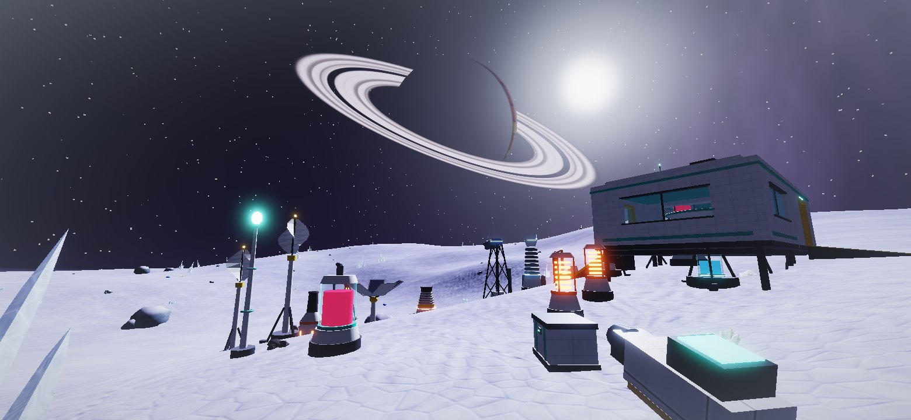
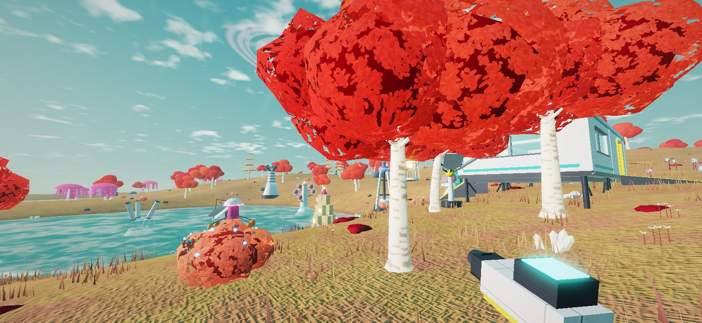

# Worldwake

A native Kotlin + OpenGL ES 3 planet terraforming game for Android, with a story. It runs fully offline.

You are Waker Seven, sent alone to the frozen moon Ysmere to finish a job nine people abandoned thirty one years ago. Build machines, warm the ground, thicken the air, make it rain, and watch a dead world come back in colours nobody expected. See [ABOUT.md](ABOUT.md) for the story, the stages and the controls.




More: [thaw](docs/thaw.jpg), [moss](docs/moss.jpg), [meadow](docs/meadow.jpg), [night](docs/night.jpg), [the Shards](docs/shards.jpg). These pictures were rendered off-device from the game's own shaders, geometry and textures (see Tools). Shadows and weather particles are not in them.

## Install
Copy `release/Worldwake.apk` to your phone and open it. You need to allow installs from unknown sources. Requires Android 8.0+ and OpenGL ES 3.0.

## What is in it
- **One planet, twelve stages.** A single number, the Wake Index, drives everything you see. The sky goes from black to violet to sea-green. Frost melts in patches. Clouds, then rain, then lakes. Then red moss, gold grass, glowing flowers and crimson trees. At the end you take your helmet off.
- **About 4 to 5 real days per planet.** Machines keep working while the game is closed, at one fifth of their pace. A pacing test models an ordinary player and fails the build if the planet stops taking around five days.
- **32 things to build:** power, heaters, bores, spore vats, seeders, extractors, storage, and living pods that join into a base you walk around in.
- **Survival:** air, water and food. Pods and the lander refill air. Supplies are used for you when a need gets low.
- **A story:** 12 crew logs to find, a suit assistant called WREN who never stops talking, and 38 standing stones that turn to look at you when you are not looking at them.
- **A 2.4 km basin** with six regions: Frost Flats, Slate Spires, the Shards, Brimstone Vents, North Terraces and the Sink. The map screen redraws itself as the ground changes.
- **Controls:** touch (a stick that appears under your left thumb, drag to look, tap to use), Xbox and PlayStation controllers, or keyboard and mouse.

## Tech
- **Renderer:** HDR with bloom and filmic tone mapping. Terrain blends four ground textures, rock on slopes, then moss, grass and frost on top, each driven by the planet stage. The sky shader draws the sun, a lit ringed gas giant with phases, stars that show in daylight while the air is thin, aurora and clouds. Water rises with the stage. Plants are instanced and grow in the vertex shader as their stage arrives. Cascaded soft shadows, FXAA and dynamic resolution.
- **World:** deterministic terrain streamed in 64 m chunks with 3 levels of detail on worker threads. All 16 textures and every model are generated in code.
- **Audio:** a software mixer with two buses. Sounds from outside pass through a filter that follows the atmosphere, so the airless world is thin and muffled and opens up as the air thickens. Suit breathing, synthesized effects, ice cracking during the thaw, and generative music that moves from a cold drone to something warm.
- **UI:** a canvas HUD and menus built from Android views. Both keep clear of the camera cutout.

## Build
```
./gradlew assembleRelease     # app/build/outputs/apk/release/app-release.apk
./gradlew testDebugUnitTest   # world, pacing, gameplay and save tests
```
The release build is signed with `keystore/worldwake.jks` (password `worldwake`). The key stays the same, so a new version installs over the old one and keeps your save.

## Tools
Three tests only do work when you point them at a folder:
- `WW_DUMP=<dir>` runs `ShaderDumpTest` and `SceneDumpTest`. They write the shaders and one frame of real geometry, textures and uniforms. `node tools/glsl.js <dir>/shaders` compiles every shader in headless Chromium. `node tools/render.js <dir> <tag> <outdir>` (with `tools/render.html` copied into `<dir>`) draws the frame with WebGL. `WW_STAGE`, `WW_TOD`, `WW_X`, `WW_Z`, `WW_YAW`, `WW_PITCH`, `WW_LAYOUT` and `WW_TAG` choose the view.
- `WW_SHOTS=<dir>` runs `UiShotTest`, which draws the real HUD and every menu to PNG at phone size with Robolectric. If Robolectric cannot download its Android image, put the `android-all-instrumented` jar in a folder and set `ROBO_DEPS` to it.
